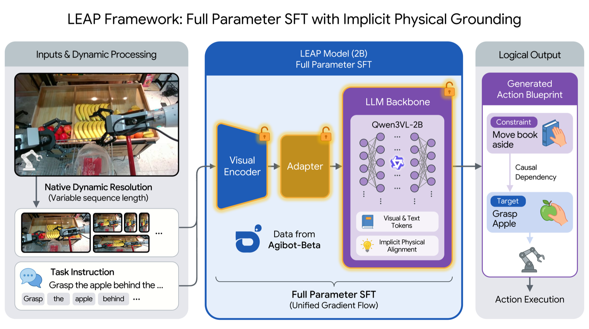
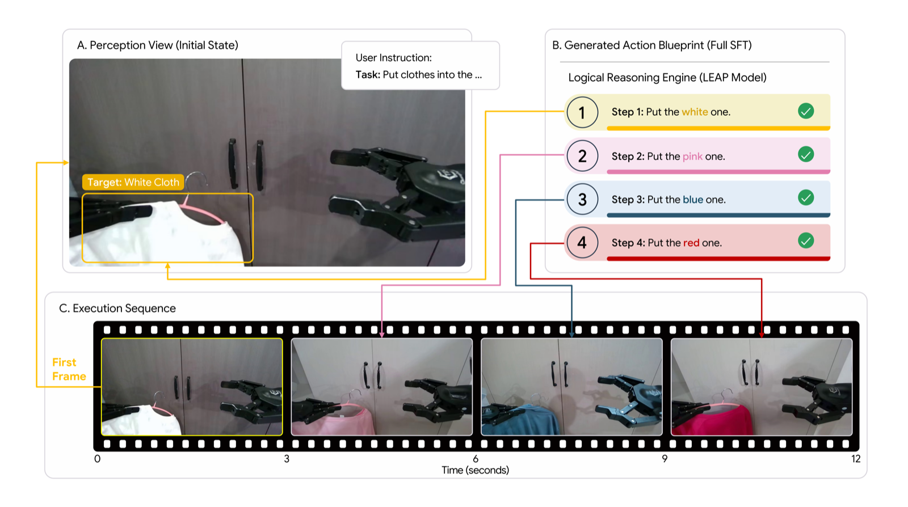

<a name="leap"></a>

# Structured Supervision Targets as a Knowledge Interface for Reliable Parser-Gated Plan Generation in Compact Vision-Language Models

<p align="center">
  <a href="README_en.md">English</a> · <b>简体中文</b>
</p>

<p align="center">
  <a href="https://huggingface.co/EvanSirius/leap-ckpts"></a>
  <a href="https://huggingface.co/datasets/EvanSirius/leap-agibot-processed"></a>
  <a href="https://huggingface.co/datasets/EvanSirius/LOVE-Agibot-Beta"></a>
  <a href="https://github.com/OpenMOSS/VLABench"></a>
  <a href="LICENSE"></a>
</p>

<p align="center">
  
</p>

## 1. 简介

本仓库为论文 **《Structured Supervision Targets as a Knowledge Interface for Reliable Parser-Gated Plan Generation in Compact Vision-Language Models》**（项目代号 **LEAP**）的官方 PyTorch 实现。本研究围绕紧凑型多模态大模型 **Qwen3-VL-2B-Instruct**，将监督目标表示形式化为连续多模态感知与离散符号执行器之间的**显式知识接口（Knowledge Interface, $\mathcal{I}_{\mathcal{K}}$）**，并通过严格受控的同域对照实验与两阶段符号契约审计揭示紧凑规划器的核心机制：

- **受控知识接口剥离（151,230 训练样本 / 184 项操作任务）**：在固定单首帧头部相机输入（$I_1$, `head_color`）、仅响应区间损失掩码（Response-Only Loss Masking）、贪婪解码及 `VLABench` 严格符号解析门禁（$\psi_{\mathrm{raw}}$）下，有序动作步监督（$\mathcal{T}_{\mathrm{steps}}$）将六维度宏平均分从基座模型的 **25.10** 提升至 **28.38**（Full SFT，$+3.29$，10,000 次配对 Bootstrap $p < 0.001$）与 **28.22**（LoRA $r=16$，$+3.13$，$p < 0.001$）；而使用完全相同图像-指令对与训练步数的**同域任务重述对照（Same-Domain Task-Restatement Control, $\mathcal{T}_{\mathrm{ctrl}}$）**仅为 **25.15**（$+0.05$），证明规划收益源自显式动作分解结构而非具身领域图像曝光。
- **两阶段符号契约审计（Two-Stage Symbolic Contract Audit, $\psi_{\mathrm{raw}} \to \psi_{\mathrm{relax}} \to \psi_{\mathrm{norm}}$）**：
  - **Stage 1（语法门禁审计）**：在全部 4,500 个评测实例上放宽 Markdown 代码围栏提取（$\psi_{\mathrm{relax}}$）实现 `0 / 4,500` 额外恢复，证明解析失败全部源于实质性生成截断或 Schema 退化；Full SFT 保持 **96.00%** 解析存活率，显著高于 LoRA 的 **87.75%**。
  - **Stage 2（实体类型归一化审计）**：消除提示词 Schema 中带引号字符串实体 ID（如 `"4"`）与 `VLABench` 真值整型实体 ID（如 `4`）之间的 Python 强类型比较失配惩罚后，Full SFT（5k）宏平均分由 `28.38` 跃升至 **38.90**（`+10.52`，技能序列准确率 **70.68%**），在全部六个能力维度上一致超越基座模型（`35.66`）与 LoRA（`33.58`）。
- **端到端可复现实验管线**：完整包含 `LOVE-Agibot-Beta` 首帧抽帧与动作步清洗、BF16 + SDPA 全量微调、四档秩 LoRA 消融（$r \in \{8, 16, 32, 64\}$）、`VLABench` 六维度评测与两阶段符号契约审计脚本。

<p align="center">
  
</p>

## 2. 仓库结构

```text
leap-code/
├── assets/               # 论文知识接口框架图与 VLABench 规划执行对比图
├── configs/              # 全局路径与训练/评测常量 (WorkspaceConfig)
├── scripts/
│   ├── download/         # 基座模型与 VLABench 评测集下载脚本
│   ├── training/         # 全量微调入口 (run-finetuning.py, run-training.sh)
│   ├── ablation/         # LoRA 消融实验脚本 (light / standard / full / aggressive)
│   ├── evaluation/       # VLABench 六维度评测、LLM-Judge 盲审与绘图脚本
│   ├── audit/            # 两阶段符号契约审计与复现核验脚本 (Stage 1 & Stage 2)
│   ├── shell/            # 多模型批量评测启动脚本
│   └── utils/            # LOVE-Agibot 数据清洗与完整性校验
├── VLABench/             # 官方评测子模块 (git submodule)
├── eval.sh               # 统一评测入口脚本
├── qwen-ft-env.yml       # Conda 环境定义
├── README.md             # 中文说明
└── README_en.md          # 英文说明
```

## 3. 快速开始

### 3.1 克隆仓库与子模块

```bash
git clone --recursive https://github.com/Evan-Joseph/leap-code.git
cd leap-code

# 若克隆时未加 --recursive，可执行：
git submodule update --init --recursive
```

### 3.2 环境配置

```bash
conda env create -f qwen-ft-env.yml
conda activate qwen-ft-env
```

### 3.3 下载模型与数据

```bash
# 1) 下载 Qwen3-VL-2B-Instruct 基座权重（内置镜像加速）
bash scripts/download/download_model.sh

# 2) 下载 VLABench 评测集（支持限流重试与断点续传）
python scripts/download/download_vlabench_with_retry.py

# 3) 校验 VLABench 数据集完整性
python scripts/utils/verify_dataset.py

# 4) 下载预处理监督数据集（151,230 训练集 / 16,812 测试集）
hf download EvanSirius/leap-agibot-processed --repo-type dataset --local-dir data/
```

### 3.4 全参微调（Full SFT）

```bash
bash scripts/training/run-training.sh
```

脚本默认读取 `data/train_151230.jsonl` 与 `models/Qwen3-VL-2B-Instruct/`，启用 BF16 混合精度、SDPA 注意力、余弦退火学习率（峰值 $1.5\times 10^{-5}$，800 步线性预热）与有效批大小 `36`（`6×6` 梯度累积），输出权重保存至 `output/`。

### 3.5 LoRA 参数高效微调（消融实验）

```bash
# 默认 standard 预设 (r=16, alpha=32)
bash scripts/ablation/run-lora-training.sh

# 指定预设档位 (light: r=8 | standard: r=16 | full: r=32 | aggressive: r=64)
bash scripts/ablation/run-lora-training.sh --preset full

# 批量运行多组消融实验
bash scripts/ablation/run-ablation-experiments.sh
```

### 3.6 VLABench 六维度评测与两阶段符号契约审计

```bash
# 1) 全维度批量评测 (M&T / CommonSense / Semantic / Spatial / PhysicalLaw / Complex)
python scripts/evaluation/run_vlm_evaluation.py \
    --checkpoint output/checkpoint-5000 \
    --dimension all

# 2) Stage 1 语法门禁敏感性审计 (\psi_raw vs. \psi_relax)
python scripts/audit/audit_parser_sensitivity.py

# 3) Stage 2 实体类型归一化契约审计 (\psi_raw vs. \psi_norm)
python scripts/audit/audit_stage2_entity_contract.py
```

## 4. 核心实验结果

### 4.1 严格解析门禁评测（$\psi_{\mathrm{raw}}$，10,000 次配对 Bootstrap 95% CI）

| 监督配置与训练方案 | M&T ↑ | Semantic ↑ | Spatial ↑ | PhysicalLaw ↑ | Complex ↑ | CommonSense ↑ | 宏平均 ($\psi_{\mathrm{raw}}$) ↑ | 95% Bootstrap CI |
| :--- | :---: | :---: | :---: | :---: | :---: | :---: | :---: | :---: |
| `Qwen3-VL-2B` (Base) | 29.60 | 25.89 | 31.10 | 24.00 | 14.28 | 25.70 | 25.10 | `[24.71, 25.48]` |
| `Same-Domain Task-Restatement Control` ($\mathcal{T}_{\mathrm{ctrl}}$) | 28.89 | 24.89 | 30.00 | 26.67 | 11.13 | 24.00 | 25.15 | `[24.75, 25.55]` |
| `Structured Steps + LoRA` ($r=16$, 5k) | **33.18** | 26.73 | 30.70 | 29.60 | 19.02 | **30.10** | 28.22 | `[27.83, 28.61]` |
| **`Structured Steps + Full SFT` (5k)** | 32.96 | **28.49** | **31.62** | **30.27** | **19.67** | 27.27 | **28.38** | **`[28.01, 28.75]`** |

### 4.2 两阶段符号契约审计（Stage 1 语法存活率 & Stage 2 实体类型归一化 $\psi_{\mathrm{norm}}$）

| 模型变体 (N = 4,500) | 解析存活率 ↑ | $\psi_{\mathrm{raw}}$ ↑ | $\psi_{\mathrm{norm}}$ ↑ | $\Delta(\psi_{\mathrm{norm}}-\psi_{\mathrm{raw}})$ | M&T | Sem. | Spa. | Phy. | Cpx. | CS | 技能匹配 ↑ | 实体匹配 ↑ | 联合步匹配 ↑ | 精确匹配 ↑ |
| :--- | :---: | :---: | :---: | :---: | :---: | :---: | :---: | :---: | :---: | :---: | :---: | :---: | :---: | :---: |
| `Qwen3-VL-2B` (Base) | 99.18% | 25.10 | 35.66 | +10.56 | 45.33 | 40.13 | 39.92 | 24.00 | 24.62 | 39.92 | 62.52% | 26.62% | 18.13% | 4.33% |
| `Structured Steps + LoRA` (5k) | 87.75% | 28.22 | 33.58 | +5.36 | 42.18 | 32.60 | 36.85 | 29.73 | 23.47 | 36.65 | 60.12% | 23.78% | 18.31% | 2.41% |
| `Structured Steps + LoRA` (7k) | 88.80% | 29.16 | 34.80 | +5.64 | 42.16 | 33.89 | 36.77 | **31.40** | 26.27 | 38.30 | 62.24% | 24.75% | 18.91% | 2.49% |
| `Structured Steps + Full SFT` (7k) | **96.42%** | 28.37 | 38.84 | +10.47 | 46.91 | 40.84 | 40.90 | 30.80 | **32.89** | 40.67 | 70.58% | 26.49% | **22.35%** | **6.71%** |
| **`Structured Steps + Full SFT` (5k)** | 96.00% | **28.38** | **38.90** | **+10.52** | **47.09** | **41.51** | **40.95** | 30.33 | 32.49 | **41.02** | **70.68%** | **26.54%** | 22.05% | 6.60% |

## 5. 数据与模型资源

| 资源名称 | 链接 | 说明 |
| :--- | :--- | :--- |
| **LEAP Checkpoints** | [EvanSirius/leap-ckpts](https://huggingface.co/EvanSirius/leap-ckpts) | Qwen3-VL-2B 全量微调权重序列 (`checkpoint-200` 至 `checkpoint-7000`) |
| **LEAP Processed Dataset** | [EvanSirius/leap-agibot-processed](https://huggingface.co/datasets/EvanSirius/leap-agibot-processed) | 结构化步骤监督训练集 (`train_151230.jsonl`)、测试集 (`test_16812.jsonl`) 及首帧图像分卷包 |
| **LOVE-Agibot-Beta** | [EvanSirius/LOVE-Agibot-Beta](https://huggingface.co/datasets/EvanSirius/LOVE-Agibot-Beta) | 按任务 ID 组织的 AgiBot-Beta 原始操作关键帧归档包（434 个任务分卷） |
| **VLABench** | [OpenMOSS/VLABench](https://github.com/OpenMOSS/VLABench) | 官方六维度长程具身任务规划评测框架（Git Submodule） |
| **基座模型** | [Qwen/Qwen3-VL-2B-Instruct](https://huggingface.co/Qwen/Qwen3-VL-2B-Instruct) | Qwen3-VL 2B 指令微调版基座模型 |

## 6. 引用与致谢

```bibtex
@article{gao2026structured,
  title={Structured Supervision Targets as a Knowledge Interface for Reliable Parser-Gated Plan Generation in Compact Vision-Language Models},
  author={Shenzhou Gao and Peijian Zhang},
  year={2026}
}

@article{zhang2024vlabench,
  title={VLABench: A Large-Scale Benchmark for Language-Conditioned Robotics Manipulation with Long-Horizon Reasoning Tasks},
  author={Shiduo Zhang and Zhe Xu and Peiju Liu and others},
  journal={arXiv preprint arXiv:2412.18194},
  year={2024}
}

@article{bai2025qwen3vl,
  title={Qwen3-VL Technical Report},
  author={Shuai Bai and Yuxuan Cai and Ruizhe Chen and others},
  journal={arXiv preprint arXiv:2511.21631},
  year={2025}
}
```

感谢 Qwen 团队开源 Qwen3-VL 系列模型，以及 VLABench 与 AgiBot World 团队提供高质量基准评测与真实机器人轨迹基础设施。

## License

本项目遵循 [MIT License](LICENSE) 开源协议。
